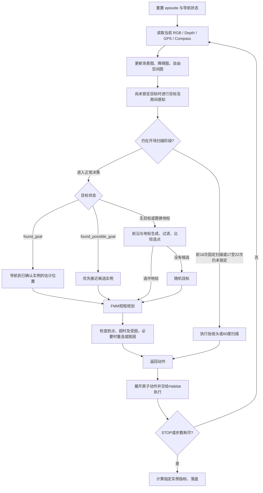

# InstanceNav 当前测评导航流程

本文初版以 2026-10-19 工作区代码为依据，实例确认与恢复流程更新至 **2026-10-29**，从默认入口 [`scripts/run_instance100.sh`](scripts/run_instance100.sh) 沿实际调用链梳理。默认指未另行设置脚本支持的环境变量、未传开关覆盖参数的情况。代码中的赋值、条件和调用优先于帮助文本、注释及旧版 README；下文单独说明两者不一致的位置。

初版梳理只阅读源码、运行配置、数据集元信息和已有日志，没有重新测评。本文描述实现与测试边界，不把静态分析当作测评分数验证。所有距离与步数均注明口径。

2026-10-23 更新：主确认方式改用 `INSTANCE_CONFIRMATION_MODE=positive_match|contradiction` 选择，默认 `positive_match`；另加默认关闭的正面确认后多图冲突复验。旧 `ENABLE_CONTRADICTION_CHECK` 已停用，使用时会报迁移提示，详见第 8.2 节。旧版复验及证据保留方案已有完整测评，见 [结果记录](outputs/results_analysis_instancenav.md)。

2026-10-29 更新：实例核验总开关统一命名为 `ENABLE_INSTANCE_CONFIRMATION`；大小物体均以候选自己的正式核验次数达到 `INSTANCE_CONFIRMATION_THRESHOLD` 后锁定，默认阈值为 1。`VERIFY_BEFORE_CANDIDATE=true` 控制独立的候选准入核验，准入通过不加锁定票。本次参数改造完成针对性测试及启动预检查，尚未重跑完整测评。

另增默认关闭的 `PRESERVE_POSITIVE_EVIDENCE_ON_RECOVERY`：受困时保留候选证据，解除导航锁定，并在实际移动、重新正面确认和候选关联后恢复接近。仅支持开启实例确认的 `positive_match`，与后置复验独立，详见第 12.6 节。

阅读顺序：第 1～2 节核对实验设置；第 3～5 节看整条调用链和每步时序；第 6～8 节看地图、场景图与实例识别；第 9～12 节看探索选点、局部规划和脱困；第 13～14 节看模型调用与评测落盘；第 15～16 节列出实现边界和源码定位。

## 1. 当前默认入口到底运行什么

脚本最终执行的主命令等价于：

```bash
PSGNAV_LOG_FILE="outputs/instancenav_val10_100_${run_timestamp}.log" \
PSGNAV_PROGRESS_FD=3 \
"$PSGNAV_PYTHON" -u PSG_Nav.py \
  --dataset instancenav \
  --dataset_split val \
  --config configs/runtime/instancenav_unseen10_1000atomic_1m.yaml \
  --rag_mode 0 \
  --episode_start 0 \
  --episode_end 100 \
  --timestamp "$run_timestamp"
```

其中解释器未指定时使用当前 PATH 中的 `python`（请先激活运行环境）。脚本切换到项目根目录后运行，`--resume` 会追加到主命令中。它没有启动 `server.py`，也没有使用 `run_parallel_with_server.py`。

### 1.1 导航开关的真实默认值

| 开关 | 当前入口实际默认值 | 生效位置与作用 |
| --- | --- | --- |
| `CUDA_VISIBLE_DEVICES` | `0` | 选择对进程可见的 GPU；代码使用可见设备中的 `cuda:0` |
| `LANDMARK_COMPARISON_REPEATS` | `1` | 每对地标比较一次 |
| `LANDMARK_COMPARISON_WORKERS` | `10` | 地标两两比较的线程池大小 |
| `ENABLE_OBJECT_RELATIONS` | `false` | 场景图物体关系查询和建边 |
| `ENABLE_GROUP_LLM_FILTER` | `true` | 对不确定的物体组标签组合进行 LLM 合理性过滤 |
| `ENABLE_ROOM_LLM_FILTER` | `true` | 对不确定的房间组合进行 LLM 合理性过滤 |
| `ENABLE_INSTANCE_CONFIRMATION` | `true` | 实例核验总开关：候选准入、正式锁定核验、后置复验和 RAG 实例核验；不控制 Group/Room 筛选 |
| `INSTANCE_CONFIRMATION_THRESHOLD` | `1` | 同一候选的正式核验通过次数达到此正整数时允许锁定，所有类别统一；总开关关闭时不生效 |
| `VERIFY_BEFORE_CANDIDATE` | `true` | 候选准入前独立核验；通过不会增加锁定次数，总开关关闭时不生效 |
| `INSTANCE_CONFIRMATION_MODE` | `positive_match` | 主确认方式：正面匹配，或 `contradiction` 显著冲突筛选 |
| `ENABLE_POST_CONFIRMATION_CONTRADICTION_CHECK` | `false` | 正面确认达到统一阈值后，用同一候选全部正面观测做一次多图冲突复验；总开关开启时仅兼容 `positive_match`，总开关关闭时不生效 |
| `PRESERVE_POSITIVE_EVIDENCE_ON_RECOVERY` | `false` | 受困时保留候选正计数；重新关联及满足恢复条件后才能锁定，仅支持开启实例确认的 `positive_match` |
| `RAG_MODE` | `0` | 默认不初始化 RAG，不检索、不收集样本 |

这些变量先取同名环境变量，再由脚本的 `--landmark-comparison-*`、`--enable-*`、`--instance-confirmation-mode`、`--instance-confirmation-threshold`、`--verify-before-candidate`、`--rag-mode` 参数覆盖。布尔值接受 `true/false/1/0/yes/no`，确认阈值、比较次数和线程数必须是正整数，RAG 模式只能是 0～3。

脚本帮助文本已与这些默认赋值一致。直接运行 Python 时，`configs/navigation_config.py` 的比较次数回退值是 3，Python 的 `--rag_mode` 默认是 3，也不同于本入口。

脚本只接收它自己列出的选项，未知参数直接退出。因此不能通过本脚本额外透传 `--visualize`、`--config` 或任意 Python 参数。当前默认 `args.visualize=False`。

### 1.2 模型与运行环境

脚本明确导出：

| 设置 | 值 |
| --- | --- |
| 模型后端 | `PSGNAV_MODEL_BACKEND=openai`，表示 OpenAI 兼容协议 |
| 实际模型名 | `QWEN_MODEL_NAME=qwen3.5-flash` |
| 模型凭据配置 | `PSGNAV_ENV_FILE=$PWD/.env` |
| 常规模型并发 | `PSGNAV_API_CONCURRENCY=8` |
| 单次输出 token 上限 | `PSGNAV_API_MAX_TOKENS=4096` |
| API 响应缓存条数 | `PSGNAV_API_CACHE_SIZE=4096` |
| 本地精确输入缓存 | `PSGNAV_EXACT_CACHE=1` |
| TF32、Torch CPU 线程 | `PSGNAV_TF32=1`、`PSGNAV_TORCH_THREADS=4` |
| Hugging Face | 项目内缓存目录，`HF_HUB_OFFLINE=1`、`TRANSFORMERS_OFFLINE=1` |
| Python 模块优先路径 | 项目内 `habitat-lab`、项目根目录、`GLIP` |

这些固定 `export` 会覆盖同名外部值。`load_dotenv(..., override=False)` 随后补充未设置的变量；所以 `.env` 不会把入口已指定的模型名改回别的模型。默认兼容接口地址来自 `utils/model_client.py`，也允许用 `DASHSCOPE_BASE_URL` 配置；本文不记录凭据。

`FlaskFunc` 是兼容类名，当前它统一调用 `ModelClient`。纯文本请求与带图请求使用同一个 Qwen 模型，没有分别运行一个本地 LLM 和一个本地 VLM。

### 1.3 启动前检查

按顺序执行：

1. 校验脚本选项与解释器可执行性。
2. 检查 `torch.load` 是否支持 `weights_only` 参数。
3. 调用 `tools/preflight_instancenav.py --config configs/runtime/instancenav_unseen10_1000atomic_1m.yaml`。
4. 检查准备好的数据集、episode 引用的场景 mesh、场景配置、GLIP/SAM/GroundingDINO 权重和关键 Python 依赖；创建模型客户端以检查模型配置和凭据是否存在。
5. 检查失败则退出，正常才进入 `PSG_Nav.py`。

入口没有传 `--check-api`，所以 preflight 默认**不会发图像探测请求验证云端可用性**。`--check-only` 执行上述检查并打印开关，然后退出，不加载完整导航 Agent、不创建仿真环境。

未指定 `--timestamp` 时生成 `YYYYmmdd_HHMMSS_进程号`。普通文本和异常写入 `outputs/instancenav_val10_100_<timestamp>.log`；fd 3 保留给终端参数和进度行。

## 2. 配置、样本和任务信息边界

### 2.1 当前实际配置

入口显式指定 [`configs/runtime/instancenav_unseen10_1000atomic_1m.yaml`](configs/runtime/instancenav_unseen10_1000atomic_1m.yaml)，覆盖注册表中 `instancenav` 的 `configs/instancenav_val20_qwen.yaml` 默认配置。

`main()` 将该配置复制到 `/tmp/psgnav_runtime_configs/instancenav_unseen10_1000atomic_1m.val.yaml`，只替换 `DATASET.SPLIT`，再设置 `CHALLENGE_CONFIG_FILE`。Agent 和 Challenge 使用同一份运行配置，Habitat 未显式指定的字段由仓库内 `habitat/config/default.py` 补足。

| 配置项 | 实际值及含义 |
| --- | --- |
| `SEED` | 77；主入口设置 Python、NumPy、Torch 随机种子 |
| 数据集类型 | `PSGInstanceNav-v1` |
| split | `val`；这里的 unseen 指官方未见验证场景，不是名为 `val_unseen` 的 split |
| 数据文件 | `data/datasets/instancenav/val10/val10.json.gz` |
| 场景根目录 | `data/scene_datasets` |
| episode 范围 | 迭代器全局索引 `[0,100)`，不是每个场景各跑 100 个 |
| 最大步数 | 1000 个原子动作，`ATOMIC_ACTIONS=True` |
| 迭代器 | `SHUFFLE=False`、`CYCLE=False`、不按步数强制切场景；继承 `GROUP_BY_SCENE=True` |
| 仿真前进步长 | YAML 未覆盖，继承 **0.25 m** |
| 左右转、抬低头 | 都是 **30°**；策略动作 6 是 60° 扫描转身 |
| Agent | 高 0.88 m、半径 0.18 m，禁止 sliding |
| RGB / 深度 | 640×480、水平 FOV 79°、传感器高 0.88 m |
| 深度 | 不归一化，米制，范围 0.5～10 m |
| 策略传感器 | RGB、Depth、GPS、Compass、ObjectGoal |
| 语义传感器 | YAML 有定义，但 `AGENT_0.SENSORS` 未启用 |
| 规划停止距离 | `TASK.STOP_DISTANCE=1.0` m，作用于预测目标的 FMM 距离 |
| 成功判定 | 执行 STOP，且到指定实例视点的测地距离 **< 1.0 m** |
| 评测指标 | DistanceToGoal、Success、SPL、SoftSPL |

### 2.2 固定 100 个 episode 的来源

读取当前数据文件与 `val10.manifest.json` 得到：

- 从 1000 个官方验证 episode 中选取 10%，seed=77，得到 100 个 episode。
- 涉及 31 个场景、99 个不同的实例 goal 键；episode 数不等于不同目标实例数。
- 类别数量：chair 50、plant 14、bed 13、tv_monitor 11、sofa 7、toilet 5。
- 当前 gzip 文件 SHA-256：`8c0a555bf6e0607bbf77c62e7139adcc4fdfe3085f90620628d78a672591c815`，与 manifest 一致。

准备逻辑在 `tools/prepare_instancenav.py:17`：先按 `(scene_id, episode_id, goal_object_id)` 排序，再 `random.Random(77).shuffle`，取 `floor(N*0.1)`；保留源 episode ID，缺少描述或目标视点会报错。准备脚本自身的默认 fraction 是 0.2，但当前入口只读取已准备好的 val10 文件，**每次启动不会重新抽样**。

Habitat 的 `EpisodeIterator` 仍按场景分组：场景按在样本中第一次出现的次序排列，同场景 episode 保持相对次序。因此测评遍历顺序不必等于 gzip 中逐行顺序，续跑检查的是实际迭代顺序。

### 2.3 InstanceNav 如何与普通 ObjectNav 区分

[`utils/instancenav_dataset.py`](utils/instancenav_dataset.py) 注册 `PSGInstanceNav-v1`：

1. 用 `场景 basename 的第一个点之前部分 + '_' + goal_object_id` 定位目标。
2. 每个 episode 只挂接该指定实例的一个 `ObjectGoal`。
3. 该 goal 的 `view_points` 转为 Habitat 的 `ObjectViewLocation`。
4. 附带 `goal_attributes`，要求其非空；重写场景路径。

策略实际使用 `object_category` 以及描述中的 `intrinsic_attributes`、`extrinsic_attributes`。`goal_attributes.image`、`goal_image_id`、真实 `goal_object_id` 和真值视点没有传入实例核验提示词。目标位置由当前 RGB/Depth/GPS/Compass 估计；真值视点在 Habitat 指标端用于评测。

这属于调用路径上的信息边界，不是权限隔离：Agent 持有 `agent.simulator`，可以接触 episode 与指标；当前默认选点和规划代码没有用真值 goal 坐标直接规划。RAG=0 时，评测结果也不会用于建立跨 episode 的检索库。

## 3. 从入口到动作的调用链

```text
scripts/run_instance100.sh
  ├─ tools/preflight_instancenav.py
  └─ PSG_Nav.py:main
       ├─ 注册 InstanceNavDataset
       ├─ 生成运行 YAML、设置 seed
       ├─ PSG_Nav_Agent.__init__             模型、地图、管理器初始化
       └─ habitat.Challenge.submit
            └─ Benchmark.local_evaluate
                 ├─ Env.reset → Agent.reset
                 ├─ 循环直到 episode_over
                 │    ├─ Agent.act(observations)
                 │    │    ├─ SceneGraph.update_scenegraph
                 │    │    ├─ MapManager.update_map / update_free_map
                 │    │    ├─ SceneGraph.perception
                 │    │    │    └─ ObjectDetectionManager → 实例核验
                 │    │    ├─ 开场扫描 / 目标优先级 / fbe
                 │    │    │    └─ LandmarkMap → 组合过滤 → LandmarkSelector
                 │    │    └─ _plan → FMMPlanner / 脱困处理
                 │    ├─ expand_atomic_actions
                 │    ├─ Env.step（每个原子动作各调用一次）
                 │    └─ Agent.update_metrics
                 └─ 汇总、保存结果，进入下一 episode
```



图展示模块关系；一次 `act()` 内可能多次调用 `fbe()` 和规划器，准确分支次序见后文。

## 4. 初始化、重置和关键状态

### 4.1 整个进程只初始化一次的部分

`PSG_Nav_Agent.__init__`（`PSG_Nav.py:55`）依次完成：

1. 设置 Torch 线程、TF32；初始化 InstanceNav 的统一类别表。
2. 加载默认检测器 GLIP：Swin-L 配置、`GLIP/MODEL/glip_large_model.pth`、输入最短边 800、置信度阈值 0.61、CUDA。
3. 建立 `MapManager`、`LandmarkManager`、`LandmarkSelector`、`NavigationPlanner`、`ObjectDetectionManager`。
4. 分配 40 m×40 m、分辨率 5 cm 的地图，即 800×800 栅格；建立障碍、自由空间、9 类房间三个投影模块。
5. 读取并归一化 `tools/obj.npy`、`tools/room.npy` 共现矩阵；当前地标评分公式没有直接引用这两张矩阵。
6. 初始化 `SceneGraph`，加载 GroundingDINO Swin-T 与 SAM ViT-H；安装本地精确缓存。
7. 建立输出目录名称和 `LandmarkMap`；按 `rag_mode` 决定是否初始化 RAG。当前 mode=0，`rag_manager=None`。
8. 创建 Challenge/Env，开始评测；默认不是多个 Agent 并行跑 episode。

统一基础类别是 `chair, bed, plant, toilet, tv_monitor, sofa`。GLIP 的类别提示还追加 `heater, window, treadmill, exercise machine, staircase`，共 11 类；变量名 `categories_21` 是历史命名。房间是 bedroom、living room、bathroom、kitchen、dining room、office room、gym、lounge、laundry room 九类。

### 4.2 每个 episode 的重置

`Benchmark` 先 `Env.reset()`，再 `agent.reset()`（`PSG_Nav.py:369`）。重置步数、检测状态、目标点、地图、碰撞图、轨迹、全景缓存、受困状态、场景图节点与关系、RAG 临时窗口、不可达地标集合及枚举组合；删除当前 episode 的 `LLMFilter` 对象。模型本身和模型客户端不重新加载，客户端/精确推理缓存可继续存在。

重置时读取类别与描述，进行名称统一，例如 couch→sofa、potted_plant→plant、tv→tv_monitor；场景图中的目标别名进一步把 tv_monitor 转为 `tv`。每个 episode 新建的 `LandmarkMap` 参数是 `max_nodes=60, min_dist=8, knn=3, method='voronoi'`，不能把构造函数最初的 min_dist=5 当作回合内最终值。

| 状态 | 具体含义 |
| --- | --- |
| `total_steps` | `act()` 的策略调用计数；早期扫描也增加，达到 Agent 自己的上限后直接返回 STOP 不再增加 |
| `navigate_steps` | 只有走到 `act()` 正常末尾才增加；提前返回的扫描不增加 |
| `Env._elapsed_steps` | 实际原子动作计数，当前测评以它为准 |
| `found_goal` | 策略已接受并锁定一个目标位置，不代表 Habitat 成功 |
| `found_possible_goal` | 有值得接近的目标证据，但尚未正式锁定 |
| `goal_gps` | 已确认目标的估计局部 GPS 坐标 |
| `possible_goal_temp_gps` | 候选目标的估计位置 |
| `goal_map` | FMM 当前导航目标，可能是实例、候选、地标或随机点 |
| `goal_gps_map` | 大物体目标位置的累积检测次数；RAG 分支还可用 -1 标记误检区域 |
| `goal_gps_timestamp_map` | 各计数位置最后更新的策略步数 |
| `landmark_navigation_steps` | 非随机导航末尾累计的计数，阈值 50；代码并不只在纯地标导航时递增 |
| `not_move_steps` / `forward_no_move_count` | 位置未移动次数 / 前进失败累计次数，参与脱困判定 |
| `unreachable_landmarks` | 本回合部分恢复失败的位置记录，用于下次候选过滤 |

默认情况下，`reset_goal_detection()` 会清空正式和候选目标、目标图、正检测计数及时间戳，保留 `goal_gps_map` 中的负值误检标记。它不会清空整个环境地图和场景图。开启证据保留时，仅 `reason='stuck'` 跳过正计数与时间戳清理，候选证据也保留；`found_goal_times` 作为当前锁定状态的显示值重置，重新确认后从候选计数更新。

## 5. 每次策略调用的准确顺序与开场扫描

### 5.1 `act()` 的前半段

`PSG_Nav.py:497` 的执行顺序如下：

1. 若 `total_steps >= max_episode_steps`，直接返回动作 0；否则 `total_steps += 1`。
2. 把深度中**恰好等于 0.5** 的值改成 100，作为无效/不可用深度。保存 RGB、BGR 和深度，并清空上一帧 GLIP 可视化结果。
3. 把 Agent、目标类别、观测、已有地图/位姿等交给 SceneGraph，调用 `update_scenegraph()`。
4. 从当前 GPS/Compass 更新障碍地图和自由空间地图，计算 `agent_map_pos`。
5. 更新移动和受困计数。GPS 位移达到 0.05 m 才视为移动；朝向变化阈值是 5°。位置没动时，转身也会增加 `not_move_steps`。只有上一动作为前进且朝向基本不变才增加 `forward_no_move_count`；普通左右转在非恢复状态会清掉前进失败计数。
6. 调用 `scenegraph.perception()`：未锁定目标时做目标检测，并在偶数 `total_steps` 做房间检测。
7. 记录历史位姿，生成当前 `traversible`、FMM 起点和朝向。只有 `--visualize` 开启才调用常规可视化。
8. 才进入开场动作、正常目标分支和恢复循环。

因此，扫描阶段也会做场景图和地图更新，不是先盲转 22 次、再开始感知。场景图更新早于本步房间图更新：节点本轮房间归属读到的是先前房间证据；但 `set_observations()` 直接用本次 GPS/Compass 构造 3D 位姿矩阵，不应简单说所有场景图定位都落后一帧。

### 5.2 固定扫描动作

当前入口不启用 `real_world_playback`，所以执行以下分支：

| `total_steps` | 策略返回 | 相机变化与行为 | 对应原子动作数量 |
| --- | --- | --- | --- |
| 1 | 5：LOOK_DOWN | 下看 30°；障碍/自由空间投影器设置俯角 30° | 1 |
| 2～7 | 6：TURN_RIGHT_2 | 每次右转 60°，合计转一圈 | 12 |
| 8 | 5：LOOK_DOWN | 再下看 30°，投影器俯角设为 60° | 1 |
| 9～14 | 6：TURN_RIGHT_2 | 再转一圈 | 12 |
| 15 | 4：LOOK_UP | 回到俯角 30° | 1 |
| 16 | 4：LOOK_UP | 回到水平，投影器俯角设为 0° | 1 |
| 17～22，且尚未 `found_goal` | 6：TURN_RIGHT_2 | 保存全景 RGB/Depth，再做目标和房间检测；若这次确认目标则直接进入导航，不再返回扫描转身 | 最多 12 |

前 16 次是无条件扫描分支，即使感知提前锁定目标也会继续执行。17～22 次仅在未锁定目标时继续；全部扫描完最多消耗 **22 次策略调用、40 个原子动作**。

17～22 次存在重复检测：前面 `perception()` 已检测过一次，该全景分支又调用 `detect_objects()`；偶数步也可能重复房间检测。精确缓存可以省掉相同输入的推理，但不会跳过后续计数更新。因此目标检测“次数”不等于不同观察帧的数量。

扫描的提前返回不更新正常末尾的 `prev_action`、`last_loc`、`navigate_steps`、地标步数和朝向历史；`total_steps` 仍正常增加。17～22 次扫描分支会清零受困计数。

### 5.3 计数与动作展开

| 动作编号 | 含义 | 当前原子动作模式 |
| --- | --- | --- |
| 0 | STOP | 1 个环境动作，结束任务 |
| 1 | MOVE_FORWARD | 前进 0.25 m |
| 2 / 3 | TURN_LEFT / TURN_RIGHT | 左/右转 30° |
| 4 / 5 | LOOK_UP / LOOK_DOWN | 上/下看 30° |
| 6 | TURN_RIGHT_2 | `expand_atomic_actions()` 转成两个动作 3 |

`Benchmark` 连续执行两个 30° 转身，中间没有再次调用 `agent.act()`；只在执行完后将最终观测送入下一次决策。每个原子动作后检查 `episode_over`，所以剩一步预算时不会强行执行第二次转身。超时主要由 Habitat 的 1000 原子动作上限触发，Agent 的 1000 次策略调用保护通常更晚。

## 6. 地图、坐标与可通行区域

主要实现：`utils/map_manager.py`、`utils/utils_fmm/mapping.py`、`utils/navigation_planner.py:28`。

### 6.1 三张投影地图

| 数据 | 形状 | 来源与用途 |
| --- | --- | --- |
| `full_map` | `[1,1,800,800]` | 从深度投影得到的障碍占据地图；虽然模块名叫 Semantic_Mapping，此处是单通道 |
| `fbe_free_map` | `[1,1,800,800]` | 使用低高度区间投影的自由/已探索空间证据，供前沿、地标和信息增益使用 |
| `room_map` | `[1,9,800,800]` | GLIP 房间检测框形成类别 mask，再结合深度投影；当前输出为二值累计图 |
| `visited` / `collision_map` | `[800,800]` | 历史访问、前进受阻推断的障碍 |
| `agent_trajectory_map` | `[800,800]` | 机器人轨迹栅格，地标过滤使用 |

障碍高度区间由 `min_z_consider=20 cm` 到 `agent_height+1+50=139 cm`；自由空间投影模块使用 -150～10 cm，房间模块使用 -10～200 cm。投影器处理有效范围内的有限深度，执行点云反投影、相机角度转换、体素聚合、旋转和平移到地图；障碍/自由空间 `forward()` 的新观测二值化后做 3×3 腐蚀，再与历史地图逐格取最大值。它们主要累计证据，没有正常的全图遗忘/衰减机制。

`update_free_map()` 另外编写了机器人足迹、前后位置连线及相机前方盲区补自由空间的逻辑。注意该段当前数组维度处理存在静态可见的疑点，见第 15 节，不能把它直接当作已验证有效的地图修补。

房间检测不使用真值语义传感器：框内像素写入对应房间 mask，未知标签跳过，九通道图由房间投影器更新。调用者虽然构造并传入 `score_vec/type_prob`，但 `Semantic_Mapping.forward_()` 中按分数赋值的代码已经注释掉，当前最终做阈值二值化、腐蚀和历史最大值合并。下游名为 room probability 的值不能直接理解为经过校准的房间概率。场景图另设 `unknown` 房间节点，所以其房间节点编号比九通道检测图多一个 unknown 偏移。

### 6.2 局部 GPS 与栅格转换

地图中心在 `(20 m,20 m)`；令观测 GPS 为 `(g0,g1)`，Compass 为 `theta` 弧度：

```text
full_pose.x = 20 + g0
full_pose.y = 20 - g1
full_pose.orientation = theta * 180/pi

agent_map_pos.col = int(full_pose.x * 20)       ≈ 400 + 20*g0
agent_map_pos.row = int((40-full_pose.y)*20)    ≈ 400 + 20*g1
```

这里每米 20 格。地图生成、场景图、可视化、FMM 之间存在纵轴翻转：FMM 使用 `full_map[0,0,::-1]`；地标通常在原始投影图坐标下保存；选择器查看地标时使用 `(800-row,col)`。实际数组 `[::-1]` 的严格索引关系是 `799-row`，源码中两种写法并存，不应自行统一成一个不存在的坐标约定。

由候选中心像素 `(u,v)` 和深度 `d` 估计目标：

```text
像素水平角 alpha = (u - 320) * 79 / 640   （度，线性角度近似）
direction = compass - alpha*pi/180
target_gps[0] = gps[0] + cos(direction)*d
target_gps[1] = gps[1] - sin(direction)*d
```

这里估计的是平面点，代码未在该公式中按相机俯仰重新换算深度的水平分量。初始扫描下视时也使用同一公式。

要区分两个目标栅格：

- **检测计数图**：`goal_gps_map[row=400+20*target_gps[0], col=400-20*target_gps[1]]`；代码局部变量名为 `map_y`、`map_x`，正式目标选择再用其逆变换得到 GPS。
- **实际规划目标图**：在 `act()` 中写入 `goal_map[row=400+20*target_gps[1], col=400+20*target_gps[0]]`，并裁剪到地图边界。

地标被选中后先对坐标整体减 1，写入目标格，再 `goal_map[::-1]`。FMM 又给目标/可通行图加一格边界，起点加 1，返回短程点后减 1。排查点位时必须看清正在使用哪张图。

### 6.3 可通行地图的构造

`MapManager.get_traversible()`：

1. 将障碍预测四舍五入；将当前位置附近 5×5 区域记入 `visited` 和轨迹。
2. 对障碍做膨胀。`agent.selem=square(1)`；随后使用 `disk(agent.disk_radius)` 膨胀，加入 `collision_map`，再膨胀一次。
3. 取反成为可通行区域；强制机器人周围 3×3 和已访问格可通行。
4. 外围增加值为 1 的一格边界，交给 FMM。

当前每回合 `disk_radius=2`。虽然 `MapManager` 里定义了场景别名和 `disk_radius_config`，当前 `init_map()` 没有查询该配置来改变半径。

这张可通行图主要排除已知障碍，没有要求每格都已被 `fbe_free_map` 证明是自由空间，因此未知区域可能被规划器视为可通行。Voronoi 地标生成则额外要求位于已探索空间，两者约束不同。

## 7. 场景图如何从观测建立

每次 `act()` 都调用 `SceneGraph.update_scenegraph()`（`graph/graph_class.py:130`）；即使 `found_goal=True`，这条链仍运行。

### 7.1 2D 分割与 3D 物体合并

顺序为 `segment2d → mapping3d → get_caption → update_node → update_edge → update_group`。

1. **GroundingDINO 检测**：使用固定 `node_space`，包括床、椅子、桌子、植物、电视等，比 GLIP 的 11 类更广。`box_threshold=0.3`，`text_threshold=0.25`；输入 resize 最短边 800、最大边 1333。
2. **SAM 分割**：将 DINO 框送入 SAM ViT-H，`multimask_output=False`；保存 RGB、框、mask、SAM 分数、caption 到 `segment2d_results`。
3. **mask 过滤与点云**：面积至少 25 像素，非背景框面积不超过整图 50%，SAM mask confidence 至少 0.95；处理包含关系，结合深度、相机内参和 GPS/Compass 位姿构造点云，初始点数至少 16，体素下采样 0.025 m，DBSCAN 去噪参数 eps=0.1、min_points=10，剔除退化包围盒。
4. **跨帧合并**：按 3D 点云空间 overlap 计算相似度，导航配置门槛 `sim_threshold_spatial=0.01`；低于门槛记为负无穷。无匹配则新建物体，否则合并到空间相似度最大的已有物体。这一步不是实例描述匹配。
5. **物体进入后处理列表**：要求 `num_detections >= cfg.obj_min_detections`，且点云最大轴向跨度 **>0.4 m**。`obj_min_detections` 会随当前目标类别设置，作用于场景图物体过滤，不是每个非目标物体各用自己的类别阈值。

当前 `use_caption_distribution=False`。类别概率来自跨帧 caption 出现频数，而非本帧 DINO softmax：`P(c)=count(c)/N`，保存众数、各类别概率、排序和熵 `-sum(P*ln(P))`。同一 3D 物体在多帧被识别成不同类别时，形成后续组合枚举的不确定性来源。

### 7.2 物体、房间、组与边

- **ObjectNode**：关联 3D 物体；中心为点云均值投影到地图。caption 变化会删除关联边并将节点标记为新节点。
- **RoomNode**：初始化 unknown 加九个房间类型，依据中心处 `room_map` 最大通道归类；无房间证据则 unknown。它是按房间**类型**聚合，不是每个物理房间一个独立实例节点。
- **GroupNode**：在同一 RoomNode 内对物体中心做 `DBSCAN(eps=10 pixels,min_samples=1)`，即邻接尺度约 0.5 m；每步重新形成组，组保存节点和边。
- **目标节点标记**：`update_node()` 使用 `node.caption in obj_goal_sg` 标记 `is_goal_node`，这是字符串包含判断，还不是 InstanceNav 的属性核验。

默认开启物体关系：新节点与旧节点、新节点彼此形成候选边。如果两个物体在某个记录帧共同出现，选两者分数和最高的共同图像，批量请求 VLM 返回短空间关系。没有共同图像的未定关系按每批最多 16 对请求文本 LLM 提议，再验证：有图时用 VLM yes/no，无图时检查同一房间、距离不超过 `800//40=20` 格、相对方位和中间自由空间采样。关系批次返回行数不匹配会被忽略，未通过验证的边删除。

关闭 `ENABLE_OBJECT_RELATIONS` 仅跳过上述关系查询/建边处理，物体节点、房间归属、分组和目标检测仍继续。

## 8. 目标候选、实例核验与正式锁定

主要实现：`utils/object_detection.py`、`utils/instance_verifier.py`。

### 8.1 常规感知入口与候选来源

`SceneGraph.perception()` 的主体包在 `if not agent.found_goal` 下：

- 运行 GLIP，得到目标及辅助类别的框、标签、分数，将 GLIP 数字标签映射为字符串。
- 用框中心深度，将 4 m 内基础类别检测写入 `obj_locations`；这不是目标计数图，也不是正式锁定。
- 根据目标类别进入两条目标分支：**plant、tv_monitor 使用场景图 mask**；**chair、bed、toilet、sofa 使用 GLIP 框**。小物体分支仍先执行 GLIP，只是目标候选最终来自场景图。
- 未锁定目标时，偶数策略步额外进行房间检测。

GLIP 目标框匹配为类别完全匹配，或双方之一是另一方的独立词；另有 gym_equipment 的历史别名分支。场景图候选则要求最新分割帧中的 caption 含目标词，且对应节点已为 `is_goal_node`、记录的 frame/mask 索引与当前分割一致。

### 8.2 InstanceNav 的属性核验

`ENABLE_INSTANCE_CONFIRMATION`（脚本参数 `--enable-instance-confirmation`）是实例核验总开关，默认开启。它控制候选准入、正式锁定核验、多图后置复验和 RAG 实例核验；`ENABLE_GROUP_LLM_FILTER`、`ENABLE_ROOM_LLM_FILTER` 各自独立。旧环境变量 `ENABLE_INSTANCE_CONFIRMATION_BEFORE_FIND_GOAL` 和旧 CLI 参数保留为兼容别名，新环境变量优先。

总开关开启时，`_verify_instance_boxes()` 分为两个独立阶段：

1. **候选准入**：`VERIFY_BEFORE_CANDIDATE=true` 时，每轮检测先核验当前框，通过后才进入候选流程；关闭时直接接受检测器提议。准入结果不增加锁定计数，远处候选也不会因此获得锁定票。
2. **正式锁定核验**：对通过准入、位置有效且距离 **<4 m** 的候选，独立调用模型。每次通过只给该候选增加 1 票；达到 `INSTANCE_CONFIRMATION_THRESHOLD`（`count >= N`，默认 1）才允许锁定。大小物体一致，不能借用相邻候选的票。距离 >=4 m 的候选只供接近，不开始锁定记票。

两阶段可以发生在同一帧，但使用独立请求及不同阶段提示词，精确缓存不会把准入回答当成正式确认。准入和正式确认都开启时，一轮近距离检测最多有两次批量核验调用；开启后置复验还会增加最终复验。此处的“独立”不代表互异视角或统计独立证据；同一步重复检测仍沿用原有可重复计票规则。

每次 `verify_candidates()` 的共同处理如下：

1. 在**当前完整 RGB 图像**上画红色候选框并从 0 编号；场景图 mask 会先转为外接框。
2. 提示词包含目标类别、内在属性和外在环境描述，要求同时参考外观和可见上下文，类别相同本身不算匹配。
3. 单次图像请求判断本分支的所有候选，返回严格长度的 `{"matches":["yes","no","unknown",...]}`。
4. `positive_match` 模式只保留 `yes`；`contradiction` 模式保留 `no/unknown`，否决 `yes`。准入通过只控制候选资格；正式确认通过才计票。
5. JSON 格式或数量错误最多进行 3 次格式尝试，重试提示词会改变以避免命中同一个坏缓存；允许明确的单元素对象列表包装。最终失败抛 `ModelRequestError`，不把异常当作“没有目标”。

图像和提示词均不包含目标标注图片或 oracle 实例 ID。可选 `PSGNAV_API_DIAGNOSTICS_DIR` 会保存最多 20 份无凭据的异常响应重放样本；默认入口没有设置该目录。

总开关关闭时，跳过上述实例核验及其子开关，`INSTANCE_CONFIRMATION_THRESHOLD` 不参与决策：大物体仍按原类别检测次数锁定，小物体仍按原近距离直接锁定流程。场景图物体预处理、Group/Room 筛选、规划和评测规则保持各自原有逻辑，因此仍按指定实例视点评分，但策略可能接受同类的错误实例。

**主确认方式切换：**`INSTANCE_CONFIRMATION_MODE=positive_match` 使用上面的整体匹配，`contradiction` 使用显著冲突筛选替代整体匹配：

```bash
bash scripts/run_instance100.sh --instance-confirmation-mode contradiction
```

默认是 `positive_match`。总开关关闭时，所选模式及核验子开关不生效。旧环境变量 `ENABLE_CONTRADICTION_CHECK` 和参数 `--enable-contradiction-check` 不再接受：旧 `true` 对应新 `contradiction`，旧 `false` 对应新 `positive_match`，需移除旧变量。

开启后仍使用同一张标好红框的观测和同样的 `matches` JSON，不读取逐条子约束。判断句改为：框中物体是否与这些内在属性和外在属性存在显著冲突。`yes` 表示存在显著冲突并否决该框；`no` 和 `unknown` 都保留。

- 否决会保存本 episode 的记录；对应候选的临时目标与旧计数会被清理，其他候选的贡献保留。场景图节点 ID 可以在当前深度无效时识别并清理旧候选。
- 证据不足不是显著冲突，因此 `unknown` 不否决，也不要求正面认定它就是目标实例。
- 历史否决复用场景图节点 ID 或原有 0.8 m 空间邻域，普通导航重置保留否决，新 episode 清空。没有节点且深度无效时只能拒绝当前框并记录定位告警，无法可靠关联之后的视角。
- 正式核验的 `no/unknown` 每次给同一候选增加 1 票，达到统一阈值后锁定。4 m 距离分支、场景图预处理、FMM 和约 1 m 停止流程保持不变，不额外增加锁定后复核。
- JSON 缺项或调用失败不能算“无冲突”；保持格式重试及明确报错。

两种核验模式都会将 `[Instance Verification]` 单行 JSON 写入运行日志 `outputs/instancenav_val10_100_<timestamp>.log`，无需额外开关。记录包含核验 ID、模式、类别、episode、导航步数，以及模型候选编号到原候选框的 `box_indices` 映射：

- `raw_response`：每次尝试的完整模型文本回复，包括格式错误的回复；换行按 JSON 转义保存。
- `result`：合法解析结果。两种模式都是 `matches`；冲突模式里 `yes` 表示显著冲突。
- `filter_result`：分别记录准入、正式核验范围、正式通过以及最终保留的原候选框编号，已考虑历史否决及同一空间候选的反证。
- `candidate_vote`：正式核验计票，包含候选 ID、当前票数及统一阈值；准入阶段不产生此事件。
- `history_skip`：因为历史反证而跳过模型核验的候选；`format_error`、`failed`、`request_error` 分别标明格式错误、格式尝试耗尽和模型调用失败。

每个阶段有独立 `verification_id`，阶段内格式重试共享 ID，`attempt` 从 1 开始。`stage=candidate_admission|goal_confirmation` 区分准入与正式核验；`candidate_pipeline` 汇总结果。模型缓存命中也记录返回结果。冲突模式用 `[Contradiction Check]` 记录每个框的 `yes/no/unknown`，用 `[Contradiction Reject]` 记录被否决的框。脚本预检查可以使用 `--check-only --instance-confirmation-mode contradiction`，不会启动导航或调用模型 API。

**正面确认后的多图复验：**在 `positive_match` 下独立启用：

```bash
bash scripts/run_instance100.sh \
  --instance-confirmation-mode positive_match \
  --enable-post-confirmation-contradiction-check true
```

| 主确认方式 | 复验开关 | 最终行为 |
| --- | --- | --- |
| `positive_match` | `false` | 正式核验 `yes` 达到统一阈值后锁定 |
| `contradiction` | `false` | 正式核验 `no/unknown` 达到统一阈值后锁定 |
| `positive_match` | `true` | 正面匹配达到统一阈值后，再做多图冲突复验 |
| `contradiction` | `true` | 配置错误 |

表中行为以实例核验总开关开启为前提；关闭总开关时复验不生效。启用复验后，大小物体两条路径都必须先通过复验，才会设置 `found_goal=True`。

- 输入为该候选在当前 episode 内所有正面匹配 `yes` 的完整 RGB 标框图，最后一张是当前正面观测。每张只标该候选，保留周围上下文；同一步重复检测只存一张，不截取最后 K 张。远处已正面匹配的图也保留。
- 图像归属优先使用场景图节点 ID；无节点时在原 0.8 m 范围内做一对一位置关联，同帧框需重叠才能复用。关联明显歧义时新建记录，避免混图。这里只用检测与深度，不读真值实例 ID；深度或关联不准仍是实现边界。
- 正式锁定始终使用候选自己的计数，按计数降序、当前距离升序选取，并使用当前观测位置。地图仍记录空间计数贡献，便于否决后只撤销该候选的贡献。复验需要当前正面观测，不能仅凭历史累计位置直接锁定当前不可见的候选。受困时是否保留计数由第 12.6 节的独立开关控制。
- 提示词只寻找清晰、显著的冲突，不要求逐项看清所有属性；遮挡、缺少参照物、光线色差、材质不明或视角造成的左右差异不直接算冲突。`conflict` 否决；合法的 `no_conflict`、`unknown` 保留此前正面结论。
- 否决后清除该候选的计数及临时目标状态，继续搜索；保留图片，不写入原冲突模式的永久否决记录。后续有新观测并再次达到确认条件时，可以重新复验。默认导航恢复清计数但保留本 episode 的图像；开启受困证据保留时，两者均保留。已否决的计数不会通过恢复重新加载，新 episode 全部清空。
- 回复只含 `decision`、`image_index`、`reason` 三个字段，使用严格 JSON Schema、关闭 thinking、temperature=0、最多 512 输出 token。冲突必须指出一个有效图片编号和简短具体原因；无冲突/不确定使用编号 -1。允许代码围栏和单元素列表这种无歧义包装，缺字段、重复字段和非法编号不能当成通过。
- **API 失败和格式错误共用最多 3 次尝试**，关闭这次请求的客户端内部重试，避免叠加成 9 次。合法判断立即结束，不因冲突而重试。三次均失败时打印每次原因并抛 `ModelRequestError`，停止测评；双 GPU 入口也会终止本次运行的另一工作进程。
- 日志模式为 `post_confirmation_contradiction`，记录候选、图片数量/哈希、观测步数、每次回复与结果。设置 `PSGNAV_LOG_FILE` 时，实际输入图和提示词保存在对应日志旁的 `<日志名去掉.log>.rechecks/<verification_id>/`，用于回放。多图顺序及所有图片内容都参与 API 缓存键。

附加 `--check-only` 只验证环境与配置。单独运行 `tools/preflight_instancenav.py --check-api` 且启用复验环境变量时，会做一次合成图片的多图结构化接口探测；它不代替导航测评。

### 8.3 大物体：深度估计、位置累计、阈值锁定

GLIP 框先按以下方式估计几何信息，核验与检测处理使用同一计算方式：

1. 取框内中央 80% 区域；先在 3×3 采样位置取深度中位数，作为遮挡判断基准。
2. 检查其他检测框与该区域重叠的部分；重叠采样深度更近则视为遮挡。
3. 用未遮挡且深度 <100 的像素平均值估计距离；无有效像素则退回粗深度。中心取框中心或未遮挡区域质心。
4. 用像素角、深度和 GPS/Compass 估计目标位置；无效深度还会尝试邻域搜索。
5. **距离 >=4 m**：准入开关开启时须先通过准入，否则直接进入接近候选流程，不写入锁定计数。候选状态与有效坐标同时写入，并遵守启用的恢复门槛。
6. **距离 <4 m**：总开关开启时，只有正式核验通过才能计票；当前位置未标为 -1 才累计。地图仍用 0.8 m 即 16 格为半宽搜索方形邻域，有正计数则给局部最大计数格加 1，否则新建计数 1，并更新时间戳；每次贡献同时记到对应候选。
7. **总开关开启**：使用候选自己的票数与 `INSTANCE_CONFIRMATION_THRESHOLD` 比较；满足当前观测、距离及可选恢复/复验条件后锁定。未达阈值的有效候选可供接近。多个候选满足条件时按票数降序、当前距离升序选择，使用当前候选坐标。
8. **总开关关闭**：保留原检测器流程，取地图最大计数，达到下表类别阈值后锁定；多个位置达标时选择时间戳最新的位置。统一核验阈值在此不生效。

| 当前目标 | 总开关关闭时的大物体 GPS 累计阈值 | 场景图预处理门槛（不由核验阈值控制） |
| --- | --- | --- |
| chair | 5 | 不走小物体目标分支 |
| bed | 5 | 不走小物体目标分支 |
| sofa | 4 | 不走小物体目标分支 |
| toilet | 2 | 不走小物体目标分支 |
| plant | 不走大物体目标分支 | 场景图物体至少 3 次检测，满足节点/当前 mask 条件后再核验 |
| tv_monitor | 不走大物体目标分支 | 场景图物体至少 2 次检测，目标别名为 tv，再核验 |

地图空间合并与候选关联都使用几何估计，不能视为真值身份追踪。总开关开启时，地图上近邻票数合并不会替代候选自己的锁定票数；关闭时保留原地图累计。两种流程均未增加“互异视角才计票”的条件，同帧重复处理仍可能重复计数。后置复验的图片按候选与策略步去重，与票数是不同口径。

代码细节：大物体框在无效深度邻域修正前已计算一次 `goal_gps`，近距离计数使用这个变量；不要假定修正后的距离一定同步重算了计数位置。只有远处 possible goal 时，位置更新也有 `possible_goal_detected_before` 分支，不能概括成每帧无条件刷新。

### 8.4 小物体：先形成场景图节点，再接受当前 mask

只消费新增的 `segment2d_results`，用目标 mask 像素均值作中心，读取中心深度；无效深度尝试邻域搜索。候选外接框按第 8.2 节执行可选准入和正式核验。

- 距离 >=4 m：只提供有效的接近目标，不计锁定票。
- 距离 <4 m 且总开关开启：按场景图节点关联候选，正式核验每通过一次加 1 票，达到统一阈值后锁定；启用多图复验时还须通过复验。
- 总开关关闭：保留原近距离通过误检位置检查后直接锁定的行为。
- 场景图形成节点所需的检测次数和点云尺寸门槛保持不变，不能当成大模型核验票数。统一阈值仅作用于进入正式核验的候选。
- 正式目标与接近目标使用当前候选的几何位置；总开关开启时按候选票数降序、距离升序选择正式目标。

### 8.5 锁定以后如何处理

一旦 `found_goal=True`，常规 `perception()` 会跳过目标和房间检测；本步后的场景图、障碍/自由地图仍继续更新，导航主要沿锁定的 `goal_gps` 前进。没有独立的“临近停止再做一次实例确认”阶段。

未锁定时，大物体分支没有候选框并不会自动清空此前所有计数/possible goal。实例核验全部不通过且此前 `found_goal=True` 的检测路径会重置目标，小物体缺少有效 mask 的相应路径也可重置；但正常锁定后这类检测入口通常不再执行。受困恢复会显式调用 `reset_goal_detection()`，重新进入搜索。

## 9. 正常导航的目标优先级

跳过开场提前返回后，`act()` 的主要分支按以下顺序执行：

| 优先级 | 条件 | 行为 |
| --- | --- | --- |
| 1 | `found_goal` | 退出随机状态，重建实例目标图，调用 `_plan(...,goal_found=True)` |
| 2 | `found_possible_goal` | 退出随机状态，以候选位置重建目标图；必要时吸附到邻近可通行格，地标步数清零，立即靠近候选 |
| 3 | 目标图为空，或满足随机目标过期条件 | 调用 `fbe()` 选地标；无地标则 `set_random_goal()` |
| 4 | 上述都不满足 | 沿当前目标图继续 `_plan()` |

候选吸附 `snap_goal_to_traversible()` 从半径 1 搜索到 15 格，首次找到有可通行格的搜索窗口就返回其中离原点最近者；最大搜索尺度约 0.75 m。正式目标没有在这里调用吸附函数，但 FMM 内部还会处理不可通行的目标格。

候选状态下若局部规划返回 STOP，则清掉 `found_possible_goal`，随后走恢复/重新选点逻辑；没有正式目标时，达到地标通常意味着继续探索。正式目标状态下规划 STOP 才通常会原样返回环境结束任务，但受困/地标计时条件仍可能先触发恢复循环。

**实际控制流不是只选点一次：**优先级 3 分支设置完 `goal_map` 没有立即规划，`number_action` 仍为初始化的 0。后面的恢复循环会再次进入“未找到目标且动作 0”分支，重新调用一次 `fbe()`，然后才规划。这会增加一次选点、组合过滤和比较的开销，不能把每次 `act()` 描述成严格一次高层决策。

## 10. FBE：前沿、Voronoi 地标与语义组合

入口是 `PSG_Nav.py:1015` 的 `fbe()`。它使用当前场景图节点和当前地图，产生一个探索目标；失败返回 `(None,None)`。

### 10.1 前沿提取

`utils/utils_frontiers.py:28` 的 `calculate_frontiers()`：

1. 自由空间值 >0 的格设为 1。
2. 障碍图以 `disk(4)` 膨胀后覆盖为 3。
3. 其余值 0 为未知；将未知区域用 `disk(1)` 膨胀。
4. 提取未知膨胀区域与自由空间交界的自由格，返回前沿 mask、所有 `[row,col]` 点和数量。

没有任何前沿时直接退出本次 FBE，不再生成地标或查询组合过滤。

### 10.2 Voronoi 地标构建

`LandmarkMap.update()` 清掉上一轮节点/边，当前用 `_update_voronoi()`：

1. 将 `fbe_free_map >0.5` 作为已探索自由空间；障碍用 3×3 矩形膨胀后从自由空间中扣除，得到 `path_map`。
2. 保留 `path_map` 的**最大连通分量**，不是强制保留机器人所在分量。
3. 用一次腐蚀提取边界；边界点超过 100 时每 9 个采样一个。边界不足 9 个时，回退到位于自由空间内的前沿原始点。
4. 对边界构造 SciPy Voronoi。节点须在地图内、已探索自由空间内和 path_map 内，周围 5×5 区域不能出现膨胀后的障碍。
5. 仅保留有限且两端有效的边；沿边栅格线检查，删去穿障碍或离开 path_map 的边。
6. 用 NetworkX 构图，连接二度节点的邻居并删除二度节点，再删除孤立节点；留下叶子/交叉点作为地标，保存简化图与边。
7. Voronoi 构造失败或没有有效图时，部分分支回退为已探索自由空间内的前沿点；外层异常则返回空节点集合。

`max_nodes=60, min_dist=8, knn=3` 虽传入构造函数，当前 Voronoi 分支没有按这三个参数执行最终截断/聚类/KNN 建边。因此 **60 不是当前地标数量的硬上限**，不能据此给两两比较次数设一个固定上界。

图用于候选生成。当前 Agent 不调用 `LandmarkMap.get_topological_path()` 沿拓扑边行走，实际移动仍交给栅格 FMM。

### 10.3 外层地标过滤与前沿中点回退

`LandmarkManager.filter_landmarks()` 使用翻转后的地标坐标检查轨迹：

- 地标周围半径 30 格的**方形**窗口只要包含历史轨迹就剔除。
- 其余候选按到 Agent 的距离排序，贪心保留彼此间距至少 30 格、约 1.5 m 的点。
- 参数说明称 `min_distance` 是到机器人的最小距离，但当前实现真正使用它的是**地标彼此间距**；没有相应的显式 Agent 距离过滤步骤。

FBE 为候选记录最近前沿距离，以 10 格/0.5 m 判断 near_frontier；选择器随后又以 **<0.2 m** 重新判定用于提示词的 near_frontier，两者不是同一个阈值。

若 Voronoi 候选为空，调用 `find_all_valid_frontier_midpoints()`：

1. 前沿点 `DBSCAN(eps=2,min_samples=2)` 聚类。
2. 按最近邻贪心排序，计算首尾直线距离/折线路径长度；动态线性度阈值从 0.80 随点数增长降到最低 0.40。
3. 取排序后的中间点，过滤轨迹邻域、与 Agent 的距离以及与已有中点的距离；中点彼此距离必须 >10 格。
4. 若能找到自由空间中的 Agent 连通分量，则先查中点距该分量的距离：<=3 格直接保留，>20 格删除；中间范围使用自由空间上的八邻域 A*，允许路径长度设置为该分量距离的两倍。

主 Agent 包装函数把最小簇大小默认为 2，覆盖 manager 自身的默认 3。它传入的 `min_linearity_ratio=0.1` 不是真正的固定过滤门槛，实际用上面的动态门槛。

两处中点回退参数不同：

| 调用时机 | 轨迹排除半径 | 离 Agent 最小距离 |
| --- | --- | --- |
| Voronoi 候选生成/外层过滤后为空 | 10 格，约 0.5 m | 26 格，约 1.3 m |
| 选择器把所有地标的信息增益过滤掉 | 21 格，约 1.05 m | 21 格，约 1.05 m |

生成候选后，FBE 还过滤距离 `unreachable_landmarks` 中任一位置 <=5 格的点。若过滤完为空，直接失败，不清空黑名单后重试。选择器之后的第二处中点回退则直接取最近中点，没有重新完整执行语义排序和不可达点过滤。

### 10.4 场景图不确定性组合

有地标后才执行以下组合链：

```text
每个物体的多帧类别概率
  → 同一个 GroupNode 内对物体类别作笛卡尔积，概率相乘
  → 每组保留 top 3，并在该 top 3 内归一化
  → 可选 Group LLM 合理性过滤（当前默认开启）
  → 每个房间用堆搜索组合其物体组，保留 top 8
  → 可选 Room LLM 合理性过滤（当前默认开启）
  → 跨房间堆搜索保留 top 16 场景图组合，并归一化
```

三个阶段的 FBE 概率门槛都传 0.0。组内枚举先完整构造笛卡尔积再取 top 3；房间/全图阶段使用对数概率和堆搜索。因此不能把所有层都理解为生成前就被 top-k 限制。

过滤器 `utils/llm_filter.py` 的实际行为：

- 概率 >=0.9999 的组/房间组合直接保留，不发 API 请求；只有不确定组合发给 LLM。
- 每批最多 32 项，文本说明房间类型和各组物体标签，要求返回 `{"plausible":[保留项的1起始编号]}`。
- 校验 JSON、唯一索引、范围；模型输出被 token 截断时二分当前批次递归处理；格式错误最多尝试 3 次，仍失败抛异常。
- 过滤修改组合容器，不删除原始 SceneGraph 的 ObjectNode，也不直接移除几何地标。
- 提示词没有输入物体关系边、目标实例描述或完整图像；不能把这个过滤器解释成验证目标实例是否存在。

如果没有任何场景图组合，FBE 跳过两两比较，尝试选择“最近地标”；该回退距离公式有坐标顺序混用，见第 15 节。如果有组合，则进入下一节的选择器。

## 11. 地标选择器的实际输入与评分公式

主入口：`utils/landmark_selector.py:42` 的 `select_best_landmark_by_comparison()`。

### 11.1 为每个地标建立描述

`_add_spatial_semantics_to_landmarks()` 记录：

- 到机器人的欧氏距离，单位 m。
- 是否靠近前沿，选择器门槛 <0.2 m。
- 在该位置预计能看见多少未知区域，以及由此定义的 explored percentage。
- 地标所在房间：直接读原始坐标的九通道 `room_map`，最大值 >0.05 才确认；否则查最近的已知房间区域（其通道值 >0.1），附距离。
- 后续追加半径 3 m 内的物体当前 caption、距离和类别熵。

主入口硬编码 `use_llm=False,use_vlm=False`，所以候选有效性用规则过滤。文件中虽然存在地图图像 VLM 过滤和 LLM 有效性过滤函数，当前路径不调用它们；这与 Group/Room 的两个 LLM 过滤开关是不同阶段。

### 11.2 射线信息增益

`_compute_information_gain_raycasting()` 的真实默认参数是 **4 m、72 条射线**，即约每 5° 一条、最长 80 格：

1. 从地标向 360° 射线行进，遇地图边界或 `obstacle_map >0.5` 停止。
2. 既不是自由格也不是障碍格的格子计为未知；射线可以继续经过未知格。
3. 用集合对所有射线命中的未知格去重，得到 `IG`。
4. 归一化分母是 `int(pi*80^2)`，约 20106，即完整圆面积，不是实际射线经过的格数。

```text
r_i = IG_i / max_possible_info_i
exploration_pct_i = 1 - r_i

有效地标：r_i >= 0.04
explored_fully 标签：r_i < 0.045
```

因此 explored percentage 是这个射线指标的变换，不是对地标周围整圆所有像素计算的真实探索覆盖率；4%～4.5% 的候选可以被保留，同时被标注为 heavily explored。注释中的 2 m、36 条射线、2.5% 等不是本路径实际数值。

### 11.3 环境语义熵与先验

对距地标 <=3 m 的物体，用跨帧标签分布计算熵并求和：

```text
H(object) = -sum_c p(c)*ln(p(c))
H_i = sum_{object within 3m of landmark i} H(object)

Hnorm_i = H_i / max_j(H_j)       （全零则为0）
Rnorm_i = r_i / max_j(r_j)       （全零则为0）
prior_i = 0.1*Hnorm_i + 0.9*Rnorm_i
```

这是代码计算的探索先验，**没有请求 LLM 输出一个先验概率**。旧注释的“50% 熵 + 50% 信息增益”与实际 0.1/0.9 权重不符。

### 11.4 两两比较

对 n 个有效地标的每个无序对比较 K 次，逻辑任务数为 `K*n*(n-1)/2`。本入口 K=1、比较线程数=20；只有一个候选时不调用比较。

每次比较先按组合概率、有放回抽样一个场景图，然后构造 A/B 文本提示。提示内容是：目标类别、目标实例内外属性、总体已探索面积、房间覆盖概况及硬编码的目标—房间常识、两地标的距离/探索描述/房间信息，以及各自最近五个邻近物体及其距离。比较是**纯文本请求**，没有附地图图像或当前 RGB。

**当前实现的重要边界：**`_add_scenegraph_semantics_to_landmark()` 明确不使用传入的 `scenegraph` 参数，实际语义描述来自前面计算的原始 ObjectNode 邻近列表。因此抽样仍发生并消耗 NumPy 随机数，但抽样组合里的替代类别和关系边没有进入比较提示词。不能将当前行为描述为“在每个抽样可能世界里用不同物体标签进行比较”。

组/房间过滤仍会影响组合是否为空、是否走最近地标回退以及计算开销；当过滤前后都保留组合时，不应声称它一定通过抽样标签改变排序提示。K>1 时同一对通常生成相同文本，API 精确缓存可能复用相同回答，所以多次比较不等于多个独立随机模型判断。

返回值要求 A 或 B；解析器容忍部分 `Landmark A` 或带标点说明的格式，解析失败直接抛 `ModelRequestError`，不会随机选一边。任务在主线程按顺序抽样和组装，线程池并发请求后按原顺序应用结果。

### 11.5 最终效用

```text
win_rate_i = win_count_i / total_comparisons_i
只有一个候选时 win_rate_i = 0.5

utility_i = 0.7*win_rate_i + 0.3*prior_i
best = argmax_i utility_i
```

平分时 NumPy `argmax` 选最先出现的候选。距离通过排序、描述和 LLM 判断间接影响结果，没有另外显式乘一个路径成本惩罚项；这里也没有执行一个拟合参数的 Bradley–Terry 求解过程。

选中点回映到原始地标下标，返回 `原始坐标-1`、下标和解释。若规则过滤后一个候选都没有，返回空，FBE 才使用前述第二处前沿中点回退；再失败由 Agent 采用随机目标。

## 12. FMM 局部规划、停止与受困恢复

### 12.1 从目标图到短程点

`PSG_Nav.py:1380` 的 `_plan()` 先处理碰撞证据，再调用 `_get_stg()`：

1. 若上一动作是前进，比较 `last_loc` 与当前位姿；位移 <0.08 m 视为碰撞，`former_collide +=1`，在前方沿朝向的约 0.20～0.40 m 处标记 5 个碰撞格；成功移动则清零。
2. 为 `goal_map` 增加一格零边界；多目标格时可按连通区域取中心。默认 `dilation_deg=0`，不会启用十字膨胀。
3. 构建 `FMMPlanner(traversible,scale=1,step_size=5)`，短程搜索窗口半径约 5 格/0.25 m。
4. `set_multi_goal()` 将目标作为距离场种子。目标有部分可通行格时保留这些格；全部不可通行时，在目标中心附近寻找可通行替代格。
5. `skfmm.distance` 生成栅格距离场；`get_short_term_goal()` 在局部窗口平滑、比较距离下降量，选择短程目标。

目标吸附不等于完整可达性保证：FMM 寻找邻近可通行格，不保证高层候选始终属于机器人同一个可达分量。`replan` 会从 FMM 返回，但当前 Agent 的主动作分支没有独立的 `if replan` 重新选点处理，主要由 STOP、受困计数和地标时限驱动后续恢复。

### 12.2 动作决策与规划 STOP

短程点方向相对当前方向的角差归一化到 [-180°,180°]：

- 大于 +16° → 动作 3，右转 30°。
- 小于 -16° → 动作 2，左转 30°。
- 其余 → 动作 1，前进。
- `former_collide>=10` 时启用转/前进交替恢复逻辑；短程点等于当前位置时也会强制尝试前进。
- FMM 的 stop 条件成立时，`_plan()` 返回动作 0。

FMM 内部阈值计算为：

```text
stop_condition_cells = max((stop_cond - decrease_stop_cond)*100/5, 0.2)
stop_cond = 0.5
```

当前正式目标指定 `STOP_DISTANCE=1.0`，因此 `decrease_stop_cond=0.5-1.0=-0.5`，阈值为 **20 格，约 1 m**。探索地标/候选分支仍使用默认 `decrease_stop_cond=-0.5`，这里也得到 20 格。判定使用平滑后的局部 FMM 距离值并作严格 `<` 比较，不是 `act()` 的欧氏距离日志，更不是到 Habitat 真值视点的距离。

**规划认为到点不等于测评成功：**正式实例位置来自视觉估计，FMM 还可能吸附到替代格；只有实际执行 STOP 后 Habitat 才按真值视点评判。没有正式目标时，动作 0 通常先被恢复循环截住，用于换地标。

### 12.3 恢复循环的进入条件与优先级

定向恢复尚未结束时，沿用已有恢复方向，跳过本步的普通目标选择与规划；其他情况下仍走原正常分支。随后运行一个 `while`，以下任一条件成立即进入：

```text
处于有效定向恢复阶段
或尚未 found_goal 且 number_action == 0
或 forward_no_move_count >= 3
或 not_move_steps >= 12
或 landmark_navigation_steps >= 50
```

每次 `act()` 最多容许 20 次循环尝试，超过时将当前非随机地标记录为不可达，设置随机目标并 `break`。

循环体按优先级处理：

1. **未受困且没有正在执行的恢复，并且（未找到正式目标且规划动作 0，或者地标计数达到 50）**：清零 `not_move_steps` 和地标计数，重新 `fbe()`；无候选则随机。已经受困时不进入这个分支，避免换地标抹掉受困计数。
2. **前进失败 >=3 或未移动 >=12**：仅在开始新恢复或 `not_move_steps>12` 超时时执行 `reset_goal_detection(reason='stuck')`，撤销此前目标锁定；正计数是否保留由开关控制。未超时的已有恢复沿用原方向，不重复初始化。超时则设置随机目标、清除恢复阶段和受困计数，并对新目标重新 `_plan()`；若返回动作 0，继续原换地标循环。
3. 若处于定向恢复阶段，输出转向或前进动作并退出循环；否则用新目标重新 `_plan()`。未受困时的目标选择、规划与 STOP 规则保持原流程。

源码注释里出现过“8 步、15 步、20 步”等旧说明，当前分支应按 **>=12、>12、>=3、>=50、最多20次内循环** 理解。

### 12.4 定向脱困

参考方向优先取朝向历史中的倒数第 4 帧；不足时取最早历史方向或当前方向。`NavigationPlanner.find_open_direction_for_stuck_recovery()` 的实际参数为：

- 在参考方向相对 -90°～+90° 范围内按 30° 扫描，剔除 [-45°,45°]，最终比较 **-90°、-60°、+60°、+90°**。
- 每个方向采样 ±30° 扇区，每 5° 一条，在 **5 和 10 格，即 0.25 m 与 0.5 m** 两个半径上检查自由空间比例。注释中的 0.5 m/1 m 不符合实际格距。
- 优先自由比例高的方向；同分时优先沿中心射线到非自由格的距离更大者；再同分优先转角绝对值较小者。没有最低自由比例门槛。
- 返回一个约 0.75 m 的候选点和绝对角度；主 Agent 只使用返回角度，忽略返回的目标图/点。
- 设置 turning 阶段；当前角度误差 <=15° 时输出前进并进入 forward 阶段，否则输出左/右转。forward 分支输出前进并清掉恢复状态。

恢复动作仍在上述 `while` 内输出，但已有恢复在下一策略步优先继续执行，不被 FBE 或新恢复覆盖方向。实际位移达到 0.05 m 时，清除恢复标志、方向和阶段，恢复正常规划；未移动超过 12 步则走随机出口。角度、动作编号、前进阶段和超时阈值沿用原规则。

### 12.5 随机探索的实际约束

`set_random_goal()` 在翻转后的 `full_map<1` 所有格中均匀随机抽一个点；若找不到才在全图随机。每次调用重设 `np.random.seed(total_steps)`。

它不检查目标是否已探索、是否属于机器人可达分量，也不把随机范围限制到前沿。相同策略步内多次调用可能抽到同一点，且重设全局 NumPy seed 会影响后续场景图采样。

两项控制流边界需特别注意：

- `act()` 前半段看到 `using_random_goal=True` 后，会先把它写为 0 再增加 `move_since_random`；后面的“随机超过 15 步换目标”却依赖 `using_random_goal` 仍为真。因此不能按注释理解为一个可靠的 15 步随机探索周期，随机时段统计也可能受影响。
- 单次 `act()` 内恢复次数用尽时，仍会设置随机目标后直接 `break`，不保证重新计算 `number_action`。若当时动作仍为 0，最终仍可能把 STOP 交给环境。长时间受困的超时出口已单独修复为重新规划，未改变此处 20 次循环上限的原有退出规则。

### 12.6 可选的受困证据保留

```bash
bash scripts/run_instance100.sh \
  --instance-confirmation-mode positive_match \
  --preserve-positive-evidence-on-recovery true \
  --enable-post-confirmation-contradiction-check true
```

最后一项也可为 `false`。开关默认关闭，关闭时受困会清零候选计数；开启时保留计数并增加恢复接近门槛。实例确认总开关开启时仅支持 `positive_match`，与 `contradiction` 组合会报错；总开关关闭时证据保留不生效。

开启后的行为：

- 仅受困重置保留各候选正计数及其历史记录，仍清除当前导航锁定、目标图和临时位置。其他重置原因保持原清理行为；新 episode 新建证据存储与恢复状态。RAG 的 -1 误检位置标记仍有效。
- 候选记录不再依赖后置复验开关。关闭复验时只保留候选、正向观测步数与计数记录，不缓存整帧图片；开启复验才保存全部正向图片。
- 大小物体均使用候选自己的正式核验票数与统一阈值比较，这一点不依赖证据保留开关。按候选计数降序、当前距离升序选择可锁定候选，并用当前观测位置重新规划。
- 当前正式核验通过的框优先关联候选；近距离正式核验失败的框不参与关联，不抢占已有候选。关闭准入核验时允许远处未核验框成为接近候选，但它们不加票、不生成正面图像，关联优先级低于正式通过的框。节点 ID 优先、无节点时一对一空间匹配的规则不变；歧义或不同节点不继承旧证据。它不是真值身份跟踪，关联错误仍可能发生。同帧重复检测的计数规则没有修改。
- 候选模式下，远距离分支不直接设置 `found_possible_goal`，统一在通过恢复门槛后同时写入接近状态和当前坐标，避免恢复期间使用已清零的临时位置。
- 受困后，新的正面观测仍可积累，但接近和锁定必须等到：策略步晚于最后一次受困重置、恢复标志及受困计数已解除、相对恢复起点观测到至少 0.05 m 位移。仅转身、等待或打印恢复完成不满足条件。
- 同一候选两次接近失败的机器人位置相距不超过 0.25 m 时，暂缓在后一次失败位置 0.5 m 范围内重新接近；证据保留，继续原恢复/探索流程。离开该范围并重新正面确认后可再次尝试。这些是本次恢复门槛，不是目标成功距离。
- 复验开启时，每次正式锁定仍要检查该候选全部历史正向图像与当前正向图像。复验否决清掉的 `votes` 不会因受困而恢复，历史图片保留不代表计数仍有效。

恢复日志使用 `mode=recovery_preservation`，记录关联、计票、重置、恢复门槛和重新锁定等事件，可核对候选编号、重置原因、保留次数、暂缓原因与重新锁定位置。该开关还包含恢复接近门槛，实验差异不能全部归因于单独取消清零。旧实现已有完整 100 任务测评，见 [结果记录](outputs/results_analysis_instancenav.md)；本次流程修复及参数改造尚未运行完整测评，默认仍为 `false`。

## 13. 模型请求、缓存、RAG 与错误传播

### 13.1 什么阶段会请求 Qwen

| 调用点 | 输入 | 输出 | 默认触发条件 |
| --- | --- | --- | --- |
| 场景图关系 | 共同 RGB 图 + 物体对 | 短空间关系 | 有新节点且关系开关开启 |
| 关系提议/验证 | 文本物体对，或图像与关系 | 每行关系、yes/no | 未定关系需要提议/验证 |
| Group/Room 组合过滤 | 房间类型、物体标签组合 | plausible 索引 JSON | 相应开关开启且存在概率 <0.9999 的组合 |
| 地标两两比较 | 地标几何/语义/房间上下文、实例文字描述 | A/B | FBE 有场景图组合且有效地标多于 1 个 |
| InstanceNav 候选准入 | 当前 RGB 标框图、类别、目标内外属性 | 每框 yes/no/unknown | 实例总开关与准入开关都开启，当前检测产生目标框；不计票 |
| InstanceNav 正式锁定核验 | 独立阶段提示词及当前 RGB 标框图、目标描述 | 每候选 yes/no/unknown | 总开关开启，已通过准入或跳过准入，位置有效且距离 <4 m；通过才计票 |
| 正面确认后冲突复验 | 当前及同候选历史正面观测的多张标框图、目标描述 | decision / image_index / reason | 默认关闭；开启后在最终锁定前触发 |

GLIP、GroundingDINO、SAM、地图投影、前沿提取、射线信息增益、熵计算和 FMM 均在本地执行。

`ModelClient` 请求设置 `temperature=0.0`、`stream=False`、`enable_thinking=False`。默认连接超时 10 s、响应超时 45 s、重试次数 2（最多 3 次 HTTP 尝试），后两项可由 `.env`/环境变量改变。408/429/500/502/503/504、连接失败或超时会有限重试；其他非成功 HTTP、空回复或未完整完成的回复会报错。

正面确认后复验单独覆盖内部重试为 0，由外层统一控制 API/格式失败最多 3 次，详见第 8.2 节。

常规关系查询的线程池大小为 8，地标比较单独使用 10。客户端共享信号量大小取 `max(8,10)=10`，所以不能把当前整个进程的模型请求上限一律写成 8。

### 13.2 缓存保留什么、不跳过什么

- **API 精确缓存**：按完整请求 payload 的 SHA-256 建键，包括提示词、图像内容、模型参数和 response format；LRU 容量 4096。相同键用分片锁去重请求，带 validator 的回答通过校验后才缓存，取缓存时还会验证。图像 PNG/base64 转换另有 32 项缓存。
- **GLIP 缓存**：相同图像、caption、阈值与 TF32 设置复用预测，并恢复 `entities/plus/...`，避免物体/房间两种提示切换导致标签解释错位。
- **DINO/GLIP 文本特征与 SAM 图像特征**：对精确相同输入复用；SAM 相对位置张量也有缓存。
- **FMM 缓存**：精确相同的场、mask 和 dx 可以复用距离结果，容量 4。
- 缓存结果复制后返回，避免调用方修改污染缓存。缓存没有把导航变成跳帧执行：场景图合并、计数、地图更新和决策仍执行，所以相同输入重复处理仍可能累加证据。

### 13.3 RAG 默认关闭，打开时的边界

模式 0=关闭、1=仅收集、2=仅使用、3=使用并收集。当前入口传 0，因此 RAG 不参与默认导航判定；但代码仍维护最近检测和长度默认 5 的临时窗口，日志出现 `[RAG Window]` 不代表真的进行了检索或落库。

若显式启用，InstanceNav 存储目录按 timestamp 隔离在 `data/rag_storage/instancenav_<timestamp>/rag_positives`。实例总开关开启时，检测确认后可检索校验，强误检可将周围 `goal_gps_map` 标为 -1 并重置目标；关闭总开关会跳过这项实例核验，收集行为仍由 RAG 模式控制。episode 结束时，成功可存最新检测，失败可把滑窗里的候选存作潜在误检。这个扩展分支会使用评测 success 反馈；它不是默认 mode=0 的行为。

### 13.4 异常不是正常失败 episode

模型基础设施错误会向上抛出。实例核验和组合过滤有各自的格式修复机制，仍失败后不会回退为否定答案或随机文本结果。`Benchmark.local_evaluate()` 的外层主要是 `try/finally` 清理终端，没有把每个模型异常吞掉后继续下一 episode 的通用逻辑。

因此模型错误可能中断整个运行；中断中的 episode 不加入 `results.txt`。启动脚本保留非零退出码并提示日志路径，已完成的回合可通过 `--resume` 保留。

## 14. Habitat 结束条件、指标、输出和续跑

### 14.1 两种主要回合结束方式

1. **执行动作 0**：`StopAction` 设置 `task.is_stop_called=True`，任务不再 active，回合结束；可以成功也可以失败。
2. **原子动作预算耗尽**：`Env._elapsed_steps >=1000` 强制结束。超时不自动补一个 STOP，因此即使已经很近，也未必满足 success。

`Env` 还保留最大秒数保护；当前 YAML 未覆盖，继承 10000000 s，实际常规约束是原子步数。每个原子动作后先更新指标，再更新步数/结束状态。

### 14.2 三种不能混淆的距离

| 距离 | 计算来源 | 使用目的 |
| --- | --- | --- |
| `agent.distance_to_goal` | 当前 Agent 与 `goal_map` 首个目标格的平面欧氏距离 | 打印/可视化，当前目标也可能只是地标 |
| FMM 距离 | 膨胀障碍下的栅格距离场与局部平滑 | 控制朝向、短程目标和规划 STOP |
| `metrics['distance_to_goal']` | Habitat 当前真实位置到**指定实例的任一视点**的最短测地距离 | 成功与 SPL/SoftSPL 评测 |

`InstanceNavDataset` 为 episode 只注入指定实例，因此不会因为抵达同类别另一实例附近就自动算成功。

设初始到目标视点的最短距离为 `d0`，结束时为 `dT`，实际累计平移路径长度为 `L`：

```text
Success = 1[显式STOP 且 dT < 1.0]
SPL = Success * d0 / max(d0,L)
SoftSuccess = max(0,1-dT/d0)
SoftSPL = SoftSuccess * d0 / max(d0,L)
```

实现位于 `habitat-lab/habitat/tasks/nav/nav.py` 的 `Success`、`SPL`、`SoftSPL`、`DistanceToGoal`。上述是正常非零 d0 情况下的代码公式；路径长度每次按真实位置变化累计，原地旋转消耗动作预算但不直接增加平移路径长度。SoftSPL 不要求 STOP 成功。

### 14.3 结果与进度文件

默认结果根目录为：

```text
data/results_instancenav_<timestamp>/experiment_0/
  results.txt          已完成episode的最终指标，每行一个Python字典文本
  results_0.txt        每回合刚reset后的初始指标
  results_avg.txt      每完成一个episode后的累计平均指标
  progress.json        原子步数、吞吐和剩余时间估计等进度

outputs/instancenav_val10_100_<timestamp>.log
scene_mappings.log     Agent.reset时追加场景ID
```

`results.txt` 每行包括距离、success、spl、softspl、原始 episode_id、scene_id、goal_object_id、统一后的 goal 类别、`num_steps`；当前原子模式额外写 `num_policy_steps=agent.total_steps` 和 `step_unit='atomic_action'`。它不是 JSONL，读取时可用 `ast.literal_eval`。

每完成一回合，重写累计结果到 `results.txt.tmp` 再 `os.replace`，使已完成前缀落盘；另两份文本直接写入。进度在一个策略动作执行完且原子步数恰为 25 的倍数，或者回合结束时更新，因此不能保证跨过每个 25 步边界都会写。`progress.json` 也以临时文件替换方式更新。

终端行显示完成回合数、当前原子步数、累计 SR/SPL、耗时、ETA。ETA 是观测吞吐推算，首次没有完整回合时按剩余回合全部跑满估计，已有完整回合后还按完成回合平均步数估计；不是承诺的完成时间。

默认关闭 `visualize`，不会通过该入口生成常规逐帧导航可视化和视频；模型关系请求用到的图像依然在内存中维护。

### 14.4 断点续跑

```bash
bash scripts/run_instance100.sh --timestamp 原运行标识 --resume
```

实际恢复流程：

1. 需要原 timestamp 对应的 `results.txt`，并要求 episode_start=0；只传 `--resume` 而不保留 timestamp 会生成新目录，随后因找不到原结果而报错。
2. 读取已完成结果，恢复汇总指标、完成数和部分辅助结果。
3. 重新初始化模型/环境；对已完成前缀逐次 `Env.reset()`，核对 `(episode_id,scene_id,goal_object_id)`，不再执行这些回合的 Agent 导航。
4. 第一个未完成回合从初始状态重新执行，地图、当前目标、恢复状态不从中断时刻恢复。
5. 前缀身份不一致或结果数量超过请求范围则报错；同 timestamp 已有结果但没传 `--resume` 也会报错，避免正常路径覆盖已有结果。

续跑保存的是完成回合前缀，不是完整策略 checkpoint。它不保存中断时的随机数状态和内存缓存，也不核对所有开关/源码/模型版本；要比较实验应另行保证这些条件一致。固定样本与 seed 不足以保证云端模型、无序集合遍历、GPU 运算及中断恢复后的轨迹逐位一致。

## 15. 阅读当前实现时必须保留的边界

### 15.1 不能套用旧注释或其他入口的结论

| 容易误读的地方 | 当前实际行为 |
| --- | --- |
| 默认跑 val20 / 500 步 / Qwen3-VL | 本入口读 val10 的 100 个 episode，1000 原子动作，qwen3.5-flash |
| 脚本 help 中 workers=10、关系与过滤默认关闭 | 实际默认 20，三个开关均 true |
| 每个场景跑 100 个 episode | 全局迭代范围 `[0,100)` |
| 开场扫描只花 22 步 | 最多 22 次策略调用、40 个原子动作，并持续感知 |
| 目标统一需要 3 次检测 | 大物体阈值按类别；小物体先依赖场景图门槛，再接受当前 mask |
| 锁定后每步复验，停止前还有最终确认 | 普通目标检测在 found_goal 后跳过，没有单独的停止前实例复验 |
| 场景图概率由当前 DINO 分类分数得到 | 当前使用多帧 caption 计数分布 |
| room_map 保存 GLIP 的连续置信度 | 当前分数赋值代码已注释，地图最终为二值累计 |
| 先验由 LLM 输出，或熵/IG 各占一半 | 代码计算，权重 0.1/0.9 |
| 信息增益使用 2 m、36 条射线 | 实际 4 m、72 条射线，分母是整圆面积 |
| 随抽样场景图切换比较语义 | 抽样参数未被语义构造函数使用，实际读原始邻近节点 |
| max_nodes=60 限制了 Voronoi 数量 | 当前 Voronoi 分支没有按该参数截断 |
| 有拓扑图就沿拓扑路径导航 | 默认只用它产候选，实际执行仍为 FMM |
| 检索日志意味着启用 RAG | mode=0 仍可能记录临时窗口，但不检索/收集 |
| 预测目标距离 1 m 就算成功 | 还需要执行 STOP，且真值指定视点测地距离严格 <1 m |

### 15.2 静态阅读发现的实现细节与疑点

以下只记录当前代码，不在本文任务中修改；涉及实际异常或轨迹影响的项目，需要单独的运行验证，已有日志也不能证明它们对应完全相同的源码快照。

1. **自由空间补图的维度。**`MapManager.update_free_map()` 取得的 `free_map_np` 按当前投影器输出是 `[1,1,H,W]`，但 `carve_square()` 用 `free_map_np[r0:r1,c0:c1]`，`cv2.line()` 也直接接受这个数组，没有先取 `[0,0]`。二维行列并未明确落在末两维，足迹/连线能否按预期生效以及 OpenCV 是否报错需验证；`prev_agent_map_pos` 只在 manager 构造时设 None，episode 重置未显式清空它。
2. **最近地标回退的坐标。**`fbe()` 在没有场景图组合时，直接拿 `[landmark[0],landmark[1]]` 与 `[agent_x,agent_y]` 相减；候选实际按 `[row,col]` 保存，其他选择分支又会翻转 row。这不是经过统一坐标变换后计算的几何最近点。
3. **房间覆盖统计跳过第一类。**`LandmarkSelector._analyze_room_coverage()` 从通道 1 开始迭代，注释认为通道 0 是 unknown；但 Agent 的九通道房间列表 0 实际是 bedroom。于是该段提供给比较提示词的房间覆盖汇总漏掉 bedroom；它与 SceneGraph 的“unknown+九类”列表不能混用。
4. **旧分割可能重新进入 3D 合并。**`segment2d()` 当前没有 caption 时不追加记录；`update_scenegraph()` 只检查历史列表长度 >0，仍可能拿最后一个旧分割记录进入 `mapping3d()`。这与小物体目标分支通过 `last_segment_num` 只消费新增分割的行为不同。
5. **状态锁定不全等于当前可见。**大物体的 possible 状态和位置计数可能在短暂无候选时保留；正式锁定后常规感知跳过检测。不能用单帧看不到目标推断内部已重置。
6. **一次调用可能多次选点。**初次给空目标图设置探索点后仍带着动作 0 进入恢复循环，可再次调用 FBE；内循环也可能多次产生 API 工作。
7. **随机状态和 STOP 的交互。**随机标记在每步前半段被清掉，15 步过期条件和随机时段统计不能照注释保证；恢复 `break` 可能保留动作 0，发生没有正式目标的 STOP。
8. **目标计数不是独立样本数。**重复处理一帧、同帧多个框、邻域合并和可能的旧分割再处理，都需要与“新视角证据”区分；精确缓存只省推理，不去除计数副作用。
9. **50 步地标计时不是纯地标状态机。**非随机正常末尾均可能递增它，正式目标分支没有一律清掉；达到 50 可以触发重新选点，即便 `found_goal` 已成立。
10. **二维地图与恢复能力的范围。**高度和俯仰通过投影参数处理，默认路径没有显式楼层切换或楼梯状态机。`utils/staircase_climber.py`、独立的 `landmark_visit_tracker.py`、`information_gain_scorer.py`、`landmark_geometry.py` 均不在当前 Agent 的这条决策调用链里，不能仅凭文件存在就把它们的功能写进默认流程。

### 15.3 已有日志能印证到什么程度

已有 `outputs/instancenav_val10_100_20261019_183945_4112000.log` 启动段记录的模型为 qwen3.5-flash，比较次数 1、workers 20、关系/组过滤/房间过滤/实例确认均开启，与脚本默认赋值相符。

另一个 `outputs/instancenav_val10_100_20261019_184410_4121709.log` 启动段记录 group_filter=False、room_filter=False。因此分析具体一次实验时应读取其 `Navigation switches`，不能把目录中所有结果都视为默认开关运行。本文不把这些尚在变化的日志片段当作完整 100 回合结果，也未据此计算最终实验结论。

## 16. 源码定位索引

以下行号对应本次阅读的工作区版本；文件继续变动后以函数名定位为准。

| 关注点 | 文件与入口 |
| --- | --- |
| 启动、开关、日志、默认 Python | [`scripts/run_instance100.sh`](scripts/run_instance100.sh) |
| 实际评测 YAML | [`configs/runtime/instancenav_unseen10_1000atomic_1m.yaml`](configs/runtime/instancenav_unseen10_1000atomic_1m.yaml) |
| 数据集默认配置注册 | [`configs/dataset_registry.py`](configs/dataset_registry.py) |
| 导航环境开关解析 | [`configs/navigation_config.py`](configs/navigation_config.py) |
| 类别统一、small_objects、类别阈值 | [`configs/dataset_categories.py`](configs/dataset_categories.py) |
| 输入检查与样本准备 | [`tools/preflight_instancenav.py`](tools/preflight_instancenav.py)、[`tools/prepare_instancenav.py`](tools/prepare_instancenav.py) |
| 指定实例与视点挂接 | [`utils/instancenav_dataset.py`](utils/instancenav_dataset.py)，`InstanceNavDataset.from_json`，48 行 |
| Agent 初始化、reset、act | [`PSG_Nav.py`](PSG_Nav.py)，55 / 369 / 497 行 |
| FBE 高层探索 | `PSG_Nav_Agent.fbe`，1015 行 |
| 遮挡处理和深度估计 | `PSG_Nav_Agent.get_unoccluded_center_point`，1209 行 |
| 规划、随机目标、指标更新、主入口 | `PSG_Nav_Agent._plan/_get_stg/set_random_goal/update_metrics`，1380 / 1446 / 1483 / 1498 行；`main`，1625 行 |
| 地图更新与可通行图 | [`utils/map_manager.py`](utils/map_manager.py)，`update_map/update_free_map/update_room_map/get_traversible` |
| 深度投影与房间二值地图 | [`utils/utils_fmm/mapping.py`](utils/utils_fmm/mapping.py)，`Semantic_Mapping.forward/forward_` |
| 场景图总流程 | [`graph/graph_class.py`](graph/graph_class.py)，`update_scenegraph`，130 行 |
| GroundingDINO + SAM | [`graph/meta_func/seg_func.py`](graph/meta_func/seg_func.py)，`get_sam_segmentation_dense` |
| 点云、caption、节点/边/组 | [`graph/meta_func/core_func.py`](graph/meta_func/core_func.py)、[`utils/utils_sg_uq/merge_utils.py`](utils/utils_sg_uq/merge_utils.py) |
| 常规感知开关与房间检测频率 | [`graph/meta_func/nav_func.py`](graph/meta_func/nav_func.py)，`perception`，69 行 |
| 大/小目标候选与累计位置 | [`utils/object_detection.py`](utils/object_detection.py)，`ObjectDetectionManager` |
| 属性核验提示词与 JSON 校验 | [`utils/instance_verifier.py`](utils/instance_verifier.py)，`verify_candidates`，59 行 |
| 前沿 | [`utils/utils_frontiers.py`](utils/utils_frontiers.py)，`calculate_frontiers`，28 行 |
| Voronoi 拓扑候选 | [`utils/landmark_map.py`](utils/landmark_map.py)，`_update_voronoi`，82 行 |
| 轨迹过滤、前沿中点与可达性 | [`utils/landmark_manager.py`](utils/landmark_manager.py) |
| 组/房间/整图组合 | [`graph/enumerated_groups.py`](graph/enumerated_groups.py)、[`graph/room_group_combinations.py`](graph/room_group_combinations.py)、[`graph/scenegraph_combinations.py`](graph/scenegraph_combinations.py) |
| 组合 LLM 过滤、分批和截断恢复 | [`utils/llm_filter.py`](utils/llm_filter.py) |
| 地标主排序、先验、比较与效用 | [`utils/landmark_selector.py`](utils/landmark_selector.py)，42 / 1066 / 1146 / 1614 行 |
| 射线信息增益 | `LandmarkSelector._compute_information_gain_raycasting`，1736 行 |
| 目标 GPS 与定向脱困 | [`utils/navigation_planner.py`](utils/navigation_planner.py)，28 / 449 行 |
| 距离场与短程点 | [`utils/utils_fmm/fmm_planner.py`](utils/utils_fmm/fmm_planner.py)，`FMMPlanner` |
| 模型后端、重试和精确响应缓存 | [`utils/model_client.py`](utils/model_client.py)、[`graph/meta_func/flask_func.py`](graph/meta_func/flask_func.py) |
| 本地推理和 FMM 缓存 | [`utils/inference_cache.py`](utils/inference_cache.py) |
| 原子动作展开 | [`utils/atomic_actions.py`](utils/atomic_actions.py) |
| 评测循环、结果、续跑 | [`habitat-lab/habitat/core/benchmark.py`](habitat-lab/habitat/core/benchmark.py)，`local_evaluate`，266 行 |
| 环境步数与结束状态 | [`habitat-lab/habitat/core/env.py`](habitat-lab/habitat/core/env.py)，`_past_limit/_update_step_stats/step` |
| 同场景 episode 重组 | [`habitat-lab/habitat/core/dataset.py`](habitat-lab/habitat/core/dataset.py)，`EpisodeIterator._group_scenes`，486 行 |
| 真值视点距离与成功/SPL | [`habitat-lab/habitat/tasks/nav/nav.py`](habitat-lab/habitat/tasks/nav/nav.py)，`DistanceToGoal/Success/SPL/SoftSPL` |
| 前进默认步长、迭代器默认值 | [`habitat-lab/habitat/config/default.py`](habitat-lab/habitat/config/default.py) |

仓库已有 `tests/test_instancenav.py`、`test_runtime_limits.py`、`test_resume.py`、`test_landmark_api.py`、`test_llm_filter_batching.py`、`test_scenegraph_edge_batching.py`、`test_inference_cache.py` 等针对部分边界的测试；本文引用其覆盖意图辅助理解，但本次未执行这些测试，也未声称所有上述实现疑点已被测试排除。
